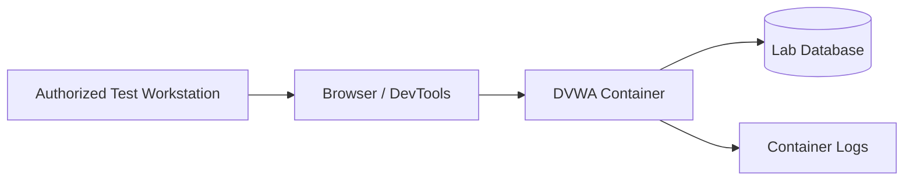

# DVWA Web Application Security Lab


## Overview

This repository documents hands-on web application security testing performed against **Damn Vulnerable Web Application (DVWA)** in an isolated environment that I own and control. The project demonstrates vulnerability identification, evidence collection, risk explanation, remediation, and professional reporting.

The current case studies cover:

- Reflected cross-site scripting (XSS)
- Stored cross-site scripting (XSS)
- SQL injection
- Security-level comparison
- Defensive remediation and validation

> **Authorization:** All testing in this repository is limited to DVWA and systems I own or am explicitly authorized to test. The examples are intentionally harmless and are not intended for use against third-party systems.

## Skills Demonstrated

- Web application security testing
- HTTP request and response analysis
- Input-validation testing
- XSS and SQL-injection fundamentals
- Risk assessment and remediation writing
- Docker lab administration
- Evidence handling and screenshot sanitation
- Technical and executive-level reporting

## Lab Architecture



The public diagram intentionally excludes real IP addresses, hostnames, credentials, and cloud-management details.

## Safety Controls

- DVWA is never used as a production application.
- The service binds to localhost by default.
- Testing is limited to an isolated lab.
- Default credentials are used only inside the disposable lab.
- No private keys, API tokens, cookies, or real account data are committed.
- Public screenshots are sanitized before upload.
- The environment is stopped when testing is complete.

## Quick Start

### Requirements

- Docker Engine or Docker Desktop
- Docker Compose
- A modern web browser

### Start the Lab

```bash
docker compose up -d
docker compose ps
```

Open:

```text
http://127.0.0.1:4280
```

On first launch, use DVWA's setup page to initialize the database. This repository does not contain real credentials or persistent production data.

### Stop the Lab

```bash
docker compose down
```

To remove the disposable lab database as well:

```bash
docker compose down -v
```

## Case Studies

| Case study | Security concept | Status |
|---|---|---|
| [Reflected XSS](labs/reflected-xss.md) | Output encoding and untrusted input | Ready for evidence |
| [Stored XSS](labs/stored-xss.md) | Persistent untrusted content | Ready for evidence |
| [SQL Injection](labs/sql-injection.md) | Parameterized queries and access control | Ready for evidence |

## Testing Method

Each case study uses the same professional workflow:

1. Define the authorized scope and objective.
2. Record the DVWA security level and environment.
3. Establish normal application behavior.
4. Submit a harmless test input.
5. Capture sanitized evidence.
6. Explain the vulnerability and potential impact.
7. Recommend remediation.
8. Retest at a stronger security level or after a defensive change.

## Repository Structure

```text
dvwa-security-lab/
├── README.md
├── compose.yaml
├── .env.example
├── .gitignore
├── LICENSE
├── docs/
│   ├── evidence-checklist.md
│   └── finding-template.md
├── labs/
│   ├── reflected-xss.md
│   ├── stored-xss.md
│   └── sql-injection.md
└── screenshots/
    └── README.md
```

## Findings Summary

| ID | Finding | Severity | Core remediation |
|---|---|---|---|
| DVWA-001 | Reflected XSS | Medium | Context-aware output encoding and validation |
| DVWA-002 | Stored XSS | High | Output encoding, validation, sanitization, and CSP |
| DVWA-003 | SQL Injection | High | Parameterized queries and least-privileged database access |

Severity labels are educational assessments for this isolated lab and are not claims about a production system.

## Roadmap

- [ ] Add sanitized setup and dashboard screenshots
- [ ] Complete reflected-XSS evidence and retest
- [ ] Complete stored-XSS evidence and retest
- [ ] Complete SQL-injection evidence and retest
- [ ] Add browser DevTools request analysis
- [ ] Add a one-page executive summary
- [ ] Add secure-coding comparisons

## Author

**Matthew Donahue**  
Cybersecurity student focused on defensive security, IT support, networking, and practical homelab experience.

